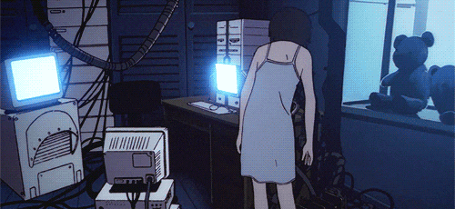

  
   Serial Experiments Lain (1998)

## Hi there 👋

Student at HTL Wien West (Media Technology), graduating 2027. I build robots, Linux setups and things that move.

- 🔭 I'm currently working on [**scara-chess**](https://github.com/tkafka42/scara-chess), a chess robot with a 2-link SCARA arm that plays on a real board (Python, OpenCV, ESP32)
- 🌱 I'm currently learning inverse kinematics, servo control, KiCad and QML
- 👯 I'm looking to collaborate on robotics and embedded projects
- 🤔 I'm looking for help with reliable piece detection under bad lighting, and gripper design
- 💬 Ask me about my [niri setup](https://github.com/tkafka42/dotfiles), ESP32 or Linux homelabs
- 📫 How to reach me: talhayigit142 [at] gmail [dot] com · [tkafka42.github.io](https://tkafka42.github.io)
- 😄 Pronouns: he/him
- ⚡ Fun fact: I plugged my power supply in backwards, burned my sound module's amplifier, and built my own transistor amp to replace it
